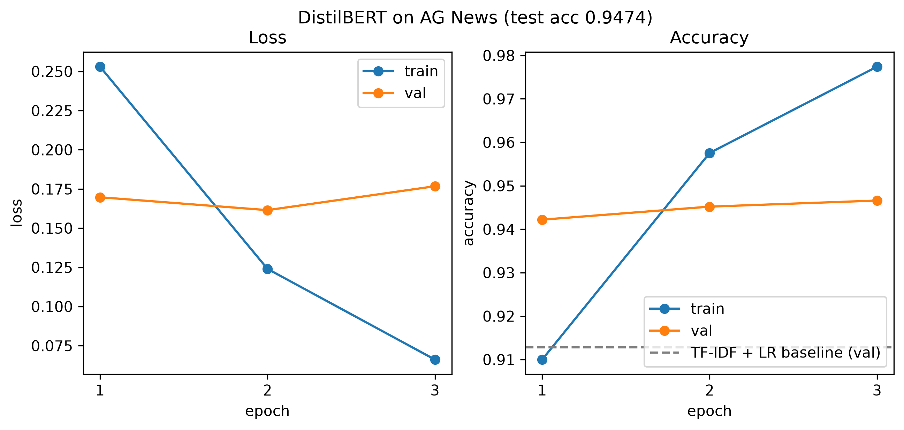
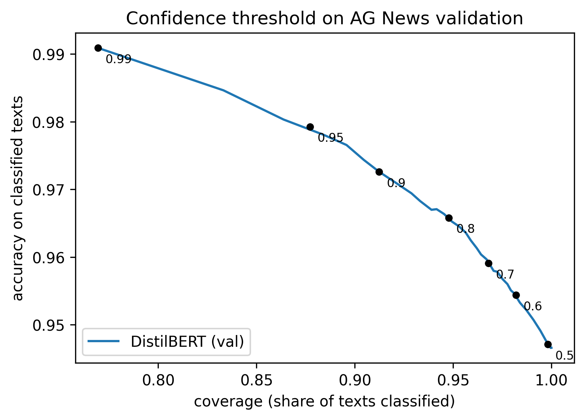

# AG News Text Classifier

DistilBERT fine-tuned on AG News with PyTorch and Hugging Face, compared with a TF-IDF baseline, and used to sort real news every day.

**Live demo: https://mengyi-an.github.io/text-classifier/** · **Model:** [callmezoey/agnews-distilbert](https://huggingface.co/callmezoey/agnews-distilbert)

The page shows today's RSS headlines (BBC, Guardian, NPR) sorted into World, Sports, Business and Sci/Tech. A GitHub Actions job updates it every day, so no server is needed.

## Features

- DistilBERT fine-tuned with a hand-written PyTorch training loop
- Comparison with a TF-IDF + logistic regression baseline
- Confidence threshold: low-confidence headlines are marked "uncertain"
- Evaluation on 100 hand-labelled real news headlines

## Results

| Model | Val acc | Test acc |
|---|---|---|
| TF-IDF + logistic regression | 91.28% | 91.72% |
| **DistilBERT** | **94.66%** | **94.74%** |



- DistilBERT beats the baseline by 3 points, cutting test errors by about a third.
- One epoch is already enough to pass the baseline; more epochs start to overfit.



- With a 0.9 threshold, 91% of test articles are still sorted and errors are cut in half (5.3% → 2.7%).
- On real 2026 news, accuracy drops to 77%: AG News is from 2004, and the model often mistakes modern topics for Sci/Tech.

## Project Structure

```
src/
  data.py          load AG News, split, tokenize
  baseline.py      TF-IDF + logistic regression
  model.py         DistilBERT classifier
  train.py         training and evaluation
  plot.py          training curves
  predict.py       class + confidence for new texts
  threshold.py     choose the confidence threshold
  fetch_rss.py     fetch RSS headlines
  daily_brief.py   classify today's news
  upload_model.py  upload the model to the Hugging Face Hub
  export_labels.py sample headlines for hand-labelling
  evaluate_rss.py  accuracy on the hand-labelled headlines
labels/            hand-labelled headlines
docs/              the web page (GitHub Pages)
figures/           result plots
```

## Usage

```bash
pip install -r requirements.txt

python -m src.baseline
python -m src.train          # -> data/model.pt
python -m src.plot           # -> figures/
python -m src.threshold      # -> figures/confidence_threshold.png
python -m src.daily_brief    # -> docs/brief.json
python -m src.evaluate_rss   # accuracy on real news

# or skip training and download the model:
hf download callmezoey/agnews-distilbert model.pt --local-dir data
```

Fine-tuning DistilBERT on a CPU is slow. If you don't have a GPU, you can use [Google Colab](https://colab.research.google.com/) with a free T4 (Runtime → Change runtime type). Clone the project into Google Drive so the results stay after the session ends:

```python
from google.colab import drive
drive.mount('/content/drive')
%cd /content/drive/MyDrive
!git clone https://github.com/Mengyi-An/text-classifier.git
%cd /content/drive/MyDrive/text-classifier
!pip install -q datasets   # Colab already has PyTorch and Transformers
!python -m src.train
```
