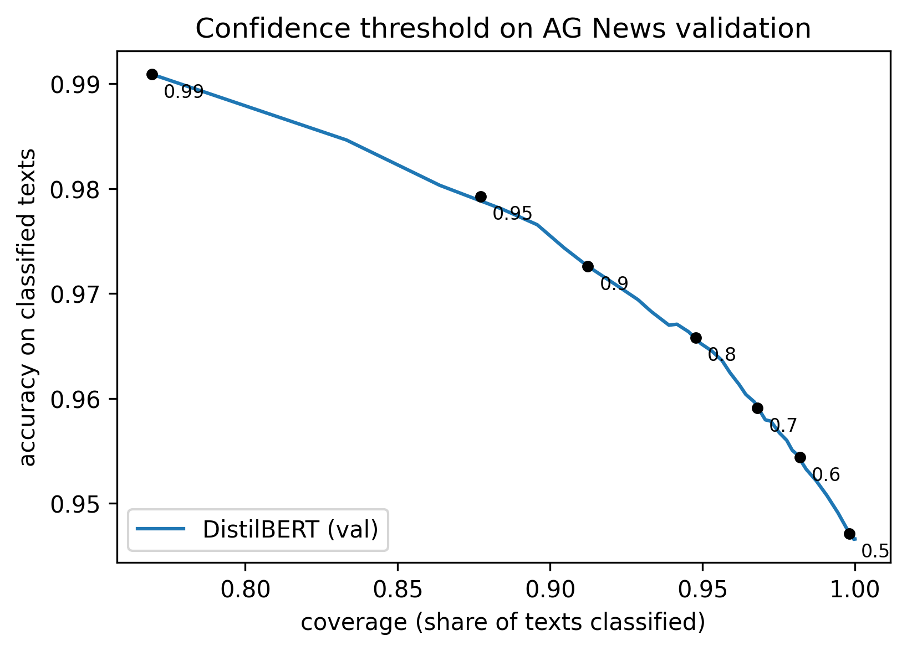

# AG News Text Classifier

A news topic classifier in PyTorch and Hugging Face: DistilBERT fine-tuned on AG News with a hand-written training loop, compared with a TF-IDF + logistic regression baseline. The trained model also sorts real RSS news every day into a live web page.

**Live demo:** [mengyi-an.github.io/text-classifier](https://mengyi-an.github.io/text-classifier/) · **Model:** [callmezoey/agnews-distilbert](https://huggingface.co/callmezoey/agnews-distilbert)

## What This Project Does

- **Data:** AG News (4 classes: World, Sports, Business, Sci/Tech), with a fixed 115k / 5k / 7.6k train / validation / test split
- **Baseline:** TF-IDF features + logistic regression (scikit-learn)
- **Model:** pretrained DistilBERT with a linear classification head on the `[CLS]` vector
- **Training:** hand-written PyTorch loop with AdamW, linear warmup and decay, dynamic padding, and `max_length` 128 (99% of articles fit without truncation)
- **Evaluation:** the best epoch is chosen on the validation set and the test set is used only once
- **Daily news sorter:** RSS headlines are classified every day; low-confidence ones are kept aside as "uncertain"

## Results

| Model                        | Best val acc     | Test acc         |
| ---------------------------- | ---------------- | ---------------- |
| TF-IDF + logistic regression | 91.28%           | 91.72%           |
| **DistilBERT**         | **94.66%** | **94.74%** |


- **DistilBERT beats the baseline by 3.0 points**, cutting test errors by about a third (8.3% → 5.3%).
- **One epoch is already enough to pass the baseline** (94.2% val acc after epoch 1).
- **More epochs start to overfit.** Validation loss is lowest after epoch 2 and rises in epoch 3, while validation accuracy improves only slightly.

## Daily News Sorter

```
RSS feeds (BBC, Guardian, NPR) -> DistilBERT -> confidence >= 0.9 ? topic : "uncertain" -> web page
```

A GitHub Actions job runs every day at 06:00 UTC: it downloads the model from the Hugging Face Hub, fetches about 200 headlines, classifies them and commits `docs/brief.json`, which GitHub Pages serves as the page above. No server is needed.

The confidence threshold was chosen on the validation set:

| Threshold | Coverage | Accuracy on covered |
| --------- | -------- | ------------------- |
| none      | 100%     | 94.7%               |
| 0.8       | 94.8%    | 96.6%               |
| **0.9**   | **91.2%**| **97.3%**           |
| 0.99      | 76.9%    | 99.1%               |



- **At 0.9, errors are cut in half** (5.3% → 2.7%) while 91% of articles are still sorted automatically.
- **Real news is harder than AG News.** On the first day of live RSS, 27% of headlines fell below 0.9, against 9% on the validation set. AG News is from 2004, so newer topics such as AI and modern politics are less familiar to the model.

## Project Structure

```
src/
  data.py        load AG News, split, tokenize
  baseline.py    TF-IDF + logistic regression
  model.py       DistilBERT classifier
  train.py       training and evaluation
  plot.py        training curves with the baseline
  predict.py     class + confidence for new texts
  threshold.py   choose the confidence threshold on validation
  fetch_rss.py   fetch and clean RSS headlines
  daily_brief.py classify today's news -> docs/brief.json
  upload_model.py  upload the model to the Hugging Face Hub
docs/            the web page (GitHub Pages)
figures/         result plots
.github/workflows/daily-brief.yml   daily job
```

## How to Run

Install the dependencies (Python 3.12):

```bash
pip install -r requirements.txt
```

Run the baseline (CPU, about a minute), then train DistilBERT and plot:

```bash
python -m src.baseline
python -m src.train      # -> data/model.pt, data/metrics.json
python -m src.plot       # -> figures/training_curves.png
```

Choose the threshold and build today's brief (needs `data/model.pt`):

```bash
python -m src.threshold      # -> figures/confidence_threshold.png
python -m src.daily_brief    # -> docs/brief.json
```

Without training, download the model first: `hf download callmezoey/agnews-distilbert model.pt --local-dir data`.

AG News and DistilBERT are downloaded automatically on the first run. Trained weights are not committed to the repository.

**No GPU?** Run the training on [Google Colab](https://colab.research.google.com/) with a free GPU (Runtime → Change runtime type → T4 GPU):

```python
from google.colab import drive
drive.mount('/content/drive')
%cd /content/drive/MyDrive
!git clone https://github.com/Mengyi-An/text-classifier.git
%cd /content/drive/MyDrive/text-classifier
!pip install -q datasets==5.1.0 transformers==5.22.1     # Colab already has PyTorch
!python -m src.train
```
