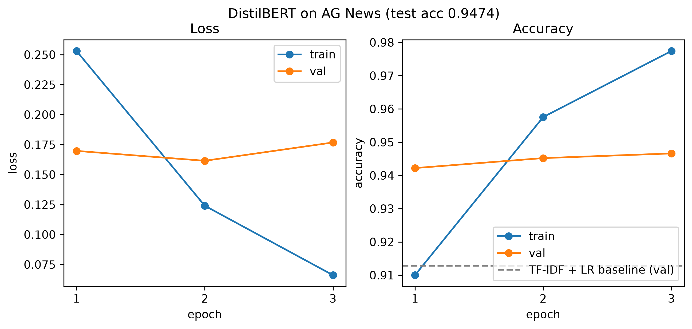

# AG News Text Classifier

A news topic classifier in PyTorch and Hugging Face: DistilBERT fine-tuned on AG News with a hand-written training loop, compared with a TF-IDF + logistic regression baseline.

## What This Project Does

- **Data:** AG News (4 classes: World, Sports, Business, Sci/Tech), with a fixed 115k / 5k / 7.6k train / validation / test split
- **Baseline:** TF-IDF features + logistic regression (scikit-learn)
- **Model:** pretrained DistilBERT with a linear classification head on the `[CLS]` vector
- **Training:** hand-written PyTorch loop with AdamW, linear warmup and decay, dynamic padding, and `max_length` 128 (99% of articles fit without truncation)
- **Evaluation:** the best epoch is chosen on the validation set and the test set is used only once

## Results

| Model                        | Best val acc     | Test acc         |
| ---------------------------- | ---------------- | ---------------- |
| TF-IDF + logistic regression | 91.28%           | 91.72%           |
| **DistilBERT**         | **94.66%** | **94.74%** |



- **DistilBERT beats the baseline by 3.0 points**, cutting test errors by about a third (8.3% → 5.3%).
- **One epoch is already enough to pass the baseline** (94.2% val acc after epoch 1).
- **More epochs start to overfit.** Validation loss is lowest after epoch 2 and rises in epoch 3, while validation accuracy improves only slightly.

## Project Structure

```
src/
  data.py        load AG News, split, tokenize
  baseline.py    TF-IDF + logistic regression
  model.py       DistilBERT classifier
  train.py       training and evaluation
  plot.py        training curves with the baseline
figures/         result plots
```

## How to Run

Install the dependencies (Python 3.12):

```bash
pip install -r requirements.txt
```

Run the baseline (CPU, about a minute), then train DistilBERT and plot:

```bash
python -m src.baseline
python -m src.train      # -> data/model.pt, data/metrics.json
python -m src.plot       # -> figures/training_curves.png
```

AG News and DistilBERT are downloaded automatically on the first run. Trained weights are not committed to the repository.

**No GPU?** Run the training on [Google Colab](https://colab.research.google.com/) with a free GPU (Runtime → Change runtime type → T4 GPU):

```python
from google.colab import drive
drive.mount('/content/drive')
%cd /content/drive/MyDrive
!git clone https://github.com/Mengyi-An/text-classifier.git
%cd /content/drive/MyDrive/text-classifier
!pip install -q datasets==5.1.0 transformers==5.22.1     # Colab already has PyTorch
!python -m src.train
```
